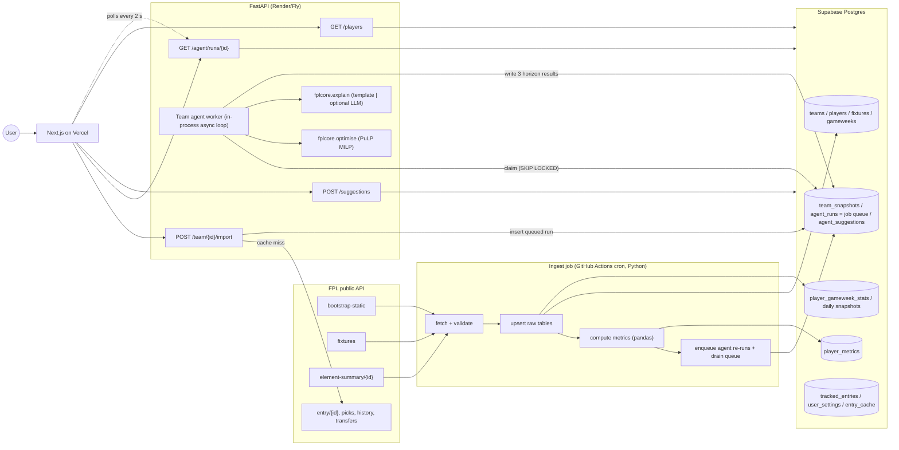

# FPL Assistant: Architecture (v1)

**Goal of v1:** a user enters their FPL team ID, the app imports their current squad (picks, bank, chips, free transfers), and a background **team agent** straight away produces three plans: next GW, next 3 GWs and next 5 GWs. Each plan covers transfers or a roll, hits, captain and vice, XI and bench, chip advice, and reasoning. Plans are scored by custom metrics, and users can change how much each metric counts.
**Not in v1:** squad builder, login-only features, the official "my team" endpoint.
**Stack:** Next.js (Vercel), Python FastAPI with pandas and PuLP (Render or Fly.io), Supabase Postgres, and a GitHub Actions cron for ingestion.
**Core principle:** the heavy work happens offline. A scheduled job ingests FPL data and precomputes each player's metric components. Each request only applies the user's weights and runs a small MILP, so it should take well under 1 second. The agent's maths is deterministic; an LLM is only an optional writer of explanations.

---

## 0. FPL API: what we verified live (12 Oct 2026, 2026/27 season, GW6 current, GW7 deadline 17 Oct 21:00 AEDT)

All of these returned HTTP 200 without auth or a User-Agent. Responses are CDN-cached (`cache-control: max-age=300`). Saved samples are in `samples/` and can be reused as test fixtures.

| Endpoint | Status | Key findings |
|---|---|---|
| `bootstrap-static/` (1.8 MB) | 200 | `elements` (667 players), `teams` (20), `events` (38), `element_types` (4), `chips`, `game_settings`, `total_players` |
| `fixtures/` | 200 | 380 fixtures: `event, kickoff_time, team_h, team_a, team_h_difficulty, team_a_difficulty, finished, started, scores, stats[]` |
| `element-summary/{id}/` | 200 | `fixtures` (upcoming, with `difficulty` and `is_home`), `history` (one row per match: `was_home, opponent_team, minutes, starts, expected_goals/assists/goal_involvements/goals_conceded, value, selected, transfers_balance`, …), `history_past` |
| `entry/{id}/` | 200 | `current_event, last_deadline_bank, last_deadline_value, last_deadline_total_transfers`, name, leagues |
| `entry/{id}/event/{gw}/picks/` | 200 | `picks[15]` (`element, position, multiplier, is_captain, is_vice_captain, element_type`), `active_chip`, `automatic_subs`, `entry_history` (`bank, value, event_transfers, event_transfers_cost`) |
| `entry/{id}/history/` | 200 | `current[]` per GW (`event_transfers, event_transfers_cost, bank, value`, …), `chips[]` used (`name, event`), `past[]` |
| `entry/{id}/transfers/` | 200 | `element_in, element_in_cost, element_out, element_out_cost, event, time` (useful for estimating purchase and selling prices) |
| `event/{gw}/live/` | 200 | per-player stats for one GW (cheap bulk alternative to 667 element-summary calls) |
| `entry/{id}/event/{next_gw}/picks/` | **404** | picks for the upcoming GW are hidden until its deadline passes |
| `my-team/{id}/` | **403** | needs login, so **selling prices and pending transfers are not available**. We estimate them instead (see §6) |
| `entry/{bad id}/` | 404 | `{"detail": ...}`, which the UI should show as "team not found" |

**Fields we confirmed on `elements`:** `expected_goals`, `expected_assists`, `expected_goal_involvements`, `expected_goals_conceded` (strings such as "1.80"), and their `*_per_90` versions (numbers). Also `form` (string), `points_per_game`, `now_cost` (int, tenths of £m), `cost_change_start`, `cost_change_event`, `selected_by_percent` (string), `transfers_in_event`, `transfers_out_event`, `chance_of_playing_this_round` and `chance_of_playing_next_round` (null/0/50/75/100 seen), `status` (a/d/i/s/u seen), `news`, `minutes`, `starts`, `ep_next`, `ict_index`, `defensive_contribution`, `can_transact`, `removed`. There are also undocumented `price_change_percent`, `price_change_projections` and `price_change_hourly_rate`. Their meaning isn't documented, so we don't rely on them.

**Gotchas we verified:**
- Numeric fields such as `form`, `expected_*` and `selected_by_percent` come as **strings**. Cast them during ingest.
- `teams[].strength_attack_*` and `strength_defence_*` are **0 for every team** right now (`strength_overall_*` is populated). Use the fixtures' FDR (`team_h_difficulty`/`team_a_difficulty`) instead.
- `game_settings`: `squad_squadsize=15`, `squad_team_limit=3`, `squad_total_spend=1000`, `max_extra_free_transfers=4` (so up to 5 FTs), `transfers_sell_on_fee=0.5`. Read these at runtime instead of hard-coding them.
- `element_types`: GKP/DEF/MID/FWD `squad_select` = 2/5/5/3, with `squad_min_play`/`squad_max_play` for formation rules.
- Chips come in **two sets per season**: wildcard, freehit, bboost and 3xc are each available once in GW1/2–19 and once in GW20–38 (`start_event`/`stop_event`).
- Free transfers aren't exposed directly. We derive them from `history.current` (§6). The rule checked out against a real entry: it gave 1 FT for GW7, which matches that entry's −4 hit in GW6.

Etiquette: this is an unofficial API. Make one bulk call per job, throttle `element-summary` to about 3 req/s, cache entry lookups for 5 minutes, and never proxy user traffic straight to FPL without caching.

---

## 1. System diagram



## 2. Components

| Component | Responsibility |
|---|---|
| `fplcore` (shared Python package) | FPL client (typed with pydantic, retries, throttling), metric functions, optimiser, FT and selling-price logic, the team agent (`fplcore.agent`) and the explainer (`fplcore.explain`). Used by both the ingest job and the API, so everything is tested in one place. |
| Ingest job (`ingest/run.py`) | Fetches, validates and upserts raw data, takes daily snapshots, and recomputes `player_metrics` for the next 6 GWs. Then it enqueues agent re-runs and drains the queue itself, so re-runs happen even while the API is asleep. Logs a row in `ingest_runs`. |
| FastAPI (`api/`) | Imports a user's team and stores a `team_snapshot`, enqueues an agent run, and serves status and results. It also handles ad-hoc `/suggestions` for slider tweaks and hosts the in-process agent worker. Stateless apart from the DB. |
| Team agent worker | Claims queued `agent_runs` from Postgres and builds the team context. It runs the optimiser for horizons 1, 3 and 5 plus the chip checks, writes structured plans, then adds explanations (template, or LLM if configured). See §6A. |
| Supabase | Postgres storage (which also serves as the job queue), plus optional Auth to save weights and team ID. RLS is on everywhere: the browser never reads tables directly, and all data goes through FastAPI. |
| Next.js (`web/`) | Team ID entry, a progress view while the agent runs, three horizon tabs with the agent's plans, weight sliders, and the player explorer. |

Repo layout (monorepo): `web/`, `api/`, `ingest/`, `fplcore/` (`client`, `metrics`, `optimise`, `agent`, `explain`), `db/schema.sql`, `samples/` (test fixtures), `.github/workflows/ingest.yml`.

## 3. Ingestion schedule

Run from GitHub Actions cron. It's free, needs no always-on server, and the regular writes keep the free Supabase project active. Cron is in UTC.

| Job | When | Calls | Notes |
|---|---|---|---|
| `bootstrap` | every 2 h | 1 | Upserts players, teams, gameweeks and positions. On the first run each day, also writes `player_daily_snapshots` (price, ownership, transfers). |
| `fixtures` | every 6 h, hourly on match days | 1 | Picks up FDR changes and rescheduled or blank fixtures. |
| `element_summaries` | daily at 03:00 UTC (14:00 AEDT), and again once `events[].data_checked` flips true after a GW | ~667 at about 3/s, roughly 4 min | Upserts `player_gameweek_stats`. Only fetch players whose `minutes` changed since the last run to cut the calls. |
| `metrics` | after any of the above | 0 | Recomputes `player_metrics` for `computed_for_gw` = next GW … next+5, with `horizon=1`. Earlier rows are kept, which lets us calibrate later (§4.3). Bumps `data_version`. |
| Pre-deadline | 2 h and 30 min before `deadline_time` | 1 + delta | Catches late injury news (`chance_of_playing_*`, `news`). |
| `agent_rerun` | after `metrics` (only when `data_version` changed), plus the 2 h pre-deadline run, plus once after the deadline when new picks are visible | 1 entry fetch per team after the deadline only | Enqueues runs for active `tracked_entries`, then drains the queue in the same Action (§6A.4). |

## 4. Metrics

All components are computed **per player, per upcoming GW k** (k = 1…6) and stored as a `*_raw` value plus a `*_score` in [0,1]. **Normalisation:** for form, xGI, value and trend, the score is the *percentile rank within position*. We use pandas `rank(pct=True)` over players with at least 1 appearance in the last 5 rounds; everyone else scores 0. Percentiles handle outliers and early-season noise well, and they keep the weights comparable. Fixture, home and minutes are naturally bounded, so they use an absolute 0–1 mapping. That way a genuinely easy fixture still scores high even if everyone's fixtures are easy.

### 4.1 Default metrics (on by default)

| Metric | Raw formula | Score | Default weight |
|---|---|---|---|
| **Form** | `0.5 × float(form) + 0.5 × EWMA(total_points per appearance, last 5 rounds, α=0.5)` | percentile within position | **0.30** |
| **Fixture difficulty** | for GW k: mean over that GW's fixtures of `ease = (5 − FDR)/4`, where FDR is `team_h_difficulty` if the player's team is home, else `team_a_difficulty` | `ease` (FDR 2→0.75, 3→0.5, 5→0) | **0.25** |
| **Home/away** | share of the player's fixtures in GW k that are at home | 1 = home, 0 = away, 0.5 for a split double | **0.10** |
| **Expected stats** | `xp90 = 0.6 × recent90 + 0.4 × season90`, shrunk to the position mean: `(m·xp90 + 270·prior)/(m+270)` where m = minutes. Points-weighted: `goal_pts[pos]·xG + 3·xA` (goal points GKP/DEF 6, MID 5, FWD 4). For GKP/DEF, add `4·exp(−xGC90)` as a clean-sheet proxy (Poisson P(0 conceded)). | percentile within position | **0.35** |

### 4.2 Optional metrics (off by default, weight 0; the UI suggests 0.15 when one is switched on)

| Metric | Raw formula | Score |
|---|---|---|
| **Value for money** | `points_per_game / (now_cost/10)` | percentile within position |
| **Minutes security** | `start_rate = starts in last 6 team matches / 6`, multiplied by `mean(min(minutes,90)/90 when started)` | direct (0–1) |
| **Price/ownership trend** | `(transfers_in_event − transfers_out_event) / total_players`, plus the 7-day change in `now_cost` from snapshots. These counters reset each deadline, so divide by hours since the deadline. | percentile across all players |

### 4.3 Combining (per request)

```
S[p,k]    = Σ_i w_i · score_i[p,k] / Σ_i w_i                   # user weights, renormalised
avail[p,k]= 1 − (1 − cop_p) · 0.5^(k−1)                         # cop = chance_of_playing_next_round/100; null & status 'a' → 1; status 'u' → 0
proj[p,k] = n_fixtures[p,k] · avail[p,k] · (a_pos + b_pos · S[p,k])   # blank GW → 0, double GW → ×2
```

`(a_pos, b_pos)` turns a score into expected points, which is needed to compare against a −4 hit. **Start with a fallback** of a=1, b=6 (S=1 is about 7 pts). Once 4 or more GWs of stored `player_metrics` exist, refit them weekly by OLS of actual points on S per position. This is why old metric rows are kept. As a sanity check, compare the correlation of `proj[p,1]` with FPL's `ep_next`.

## 5. Transfer optimisation (PuLP / CBC MILP)

Inputs: current squad C, bank B, free transfers F, selling prices sell_p, purchase prices cost_p = now_cost, horizon N (default 3), discount δ = 0.85, max hits H (default 1), and optional lock/exclude lists.

Variables (binary unless noted): `x_p` (in the squad after transfers), `in_p`, `out_p`, `s_p` (starts in GW1 of the horizon), `c_p` (captain), and integer `h ≥ 0` (paid transfers).

```
max   Σ_p proj[p,1]·(s_p + c_p + 0.1·(x_p − s_p))                # XI + captain double + small bench value
    + Σ_p Σ_{k=2..N} δ^(k−1) · proj[p,k] · x_p                     # later GWs, squad-level
    − 4·h
s.t.  x_p = [p∈C] + in_p − out_p ;  in_p ≤ 1−[p∈C] ;  out_p ≤ [p∈C]
      Σ x_p = 15 ;  Σ_{pos} x_p = 2/5/5/3                            # element_types.squad_select
      Σ_{p∈club} x_p ≤ 3                                             # game_settings.squad_team_limit
      Σ in_p·cost_p ≤ B + Σ out_p·sell_p                             # budget
      Σ in_p − F ≤ h ;  h ≤ H                                        # −4 per extra transfer
      Σ s_p = 11 ; s_p ≤ x_p ; GKP = 1 ; DEF ≥ 3 ; MID ≥ 2 ; FWD ≥ 1  # element_types min/max_play
      Σ c_p = 1 ; c_p ≤ s_p
      in_p = 0 for can_transact = false, removed, or excluded ;  out_p = 0 for locked
```

**Output:** separate solves with `Σ in_p` fixed at 0 (roll), 1, 2, …, up to F+H. Each comes back as a plan card showing projected gain against rolling, the transfers in and out with a per-metric breakdown (why), the captain and vice-captain (the next-best starter), and the remaining bank. About 700×6 variables solves with CBC in roughly 100–300 ms. Pre-filtering to the top 40 per position by S makes it even faster. Horizon-specific settings for the agent are in §6A.3, and chip advice is in §6A.4. If `active_chip` is wildcard or freehit, we treat F as unlimited.

## 6. Team import logic (no login available)

1. `entry/{id}/` gives `current_event` (the latest started GW, here 6) and `last_deadline_bank`.
2. `entry/{id}/event/{current_event}/picks/` gives the 15 elements and `entry_history.bank`.
3. **Free transfers**, derived from `history.current` and `history.chips`. FT = 1 going into GW2 (GW1 transfers are unlimited). For each later finished GW g:
   if a wildcard or freehit was played in g, keep the FT count; otherwise
   `free_used = event_transfers − event_transfers_cost/4`, then `FT = clamp(FT − free_used + 1, 1, 1 + max_extra_free_transfers)`.
   This checked out on a real entry (gave 1 FT for GW7). How FTs carry over when a WC or FH is played should be confirmed against the official rules. The UI always lets the user override FT.
4. **Selling price estimate.** The purchase price is the most recent `element_in_cost` from `entry/{id}/transfers/`. If the player was held since GW1, use `now_cost − cost_change_start`. Then `sell = buy + floor((now − buy)/2)` if now > buy, else `now`. Mark this as an estimate, since the bank can also be overridden.
5. **Caveat shown in the UI:** transfers already made for the *next* GW aren't visible until its deadline (picks return 404, my-team returns 403). The squad can be edited by hand before generating suggestions.

## 6A. Team agent (runs in the background after import)

As soon as a team is imported, the agent produces **three independent plans**: **next GW (N=1)**, **next 3 GWs (N=3)** and **next 5 GWs (N=5)**. Each plan has transfers (or a roll), any worthwhile hits, captain and vice, the starting XI and bench order, chip advice, and plain-English reasoning. **The maths is fully deterministic** (optimiser plus rules). The LLM only rewrites structured output as prose and is optional.

### 6A.1 Team context (`team_snapshots`)
On import, §6 builds an immutable snapshot that is stored once and reused by every run:
`{entry_id, event, picks[15], bank, value, free_transfers (est.), selling_prices{element: price} (est.), chips_available[] (current half only, with stop_event), chips_used[], active_chip, flags[] (squad players with status ≠ 'a' or chance_of_playing_next_round < 100, with news), overrides (user-edited FT/bank/squad)}`, plus a `content_hash`. A re-import with the same hash reuses the snapshot.

### 6A.2 How it runs asynchronously: a Postgres-backed queue (no Redis, no extra service, free)
- **Queue = the `agent_runs` table.** Status moves `queued → running → succeeded | failed`. Rows also carry `progress` (0–100) and `stage` (`context`, `horizon_1`, `horizon_3`, `horizon_5`, `chips`, `explain`).
- **Enqueue:** `POST /team/{id}/import` writes the snapshot, inserts a `queued` run, and returns `run_id` straight away (around 300 ms). A partial unique index allows at most one queued or running run per entry, so repeat clicks just get the existing run.
- **Claim:** `UPDATE agent_runs SET status='running', started_at=now(), attempts=attempts+1, locked_by=$worker WHERE id = (SELECT id FROM agent_runs WHERE status='queued' ORDER BY priority, created_at FOR UPDATE SKIP LOCKED LIMIT 1) RETURNING *`. This is safe even if two workers race.
- **Who runs it:**
  - (a) **In the API process.** On import, a FastAPI `BackgroundTasks` call claims and runs the job immediately. An asyncio loop started at app startup also polls every 5 s for anything left over.
  - (b) **In the ingest GitHub Action.** After enqueuing re-runs, the Action drains the queue itself with the same `fplcore.agent`. This means the free Render instance can be asleep and re-runs still happen.
  - There's no Celery or Redis. If load ever grows, a dedicated worker can run the same loop.
- **Reliability:** if a run has been `running` for more than 5 min, it goes back to `queued` (up to 3 attempts), then to `failed` with the `error` text. The worker is idempotent: it deletes and rewrites `agent_suggestions` for that run in one transaction.
- **Expected runtime:** a few seconds. Each horizon is about 3–6 MILP solves at 100–300 ms each, the chip checks add 3 solves, and the optional LLM call adds 2–6 s.

### 6A.3 Horizons and the optimiser
All three horizons use the §5 MILP on the same snapshot, with the user's weights. Transfers are only made **now**: v1 decides this GW's transfers and then holds the squad across the horizon. Planning future transfers across several GWs is a later enhancement.

| | N=1 | N=3 | N=5 |
|---|---|---|---|
| Objective GWs | GW+1 | GW+1…+3, δ=0.85 | GW+1…+5, δ=0.85 |
| Hit rule: take a −4 only if extra projected gain ≥ | 4 + 2.0 | 4 + 1.0 | 4 + 0.5 |
| Value of rolling, added per unused FT (up to the cap) | 2.0 | 1.0 | 0.5 |
| Max hits (default) | 1 | 1 | 2 |
| Plans returned | best, and roll as the alternative | best, roll, and best with one fewer transfer | same as N=3 |

Why it's set up this way: short horizons overrate one-week punts, so a hit has to clear a higher margin and a saved free transfer counts for more. Longer horizons spread a hit's cost over more GWs. The margins are tunable constants and get checked in the M7 backtest. The **XI, bench order and captain/vice are always picked for GW+1**, because those are the decisions due before the next deadline. For N=3/5 the output also lists each player's projection per GW so the reasoning can mention upcoming swings.

### 6A.4 Chip advice (rule-based, only for chips available in the current half)

| Chip | Check | Advise if |
|---|---|---|
| Bench Boost | sum of bench `proj` per GW in the horizon (after the plan's transfers) | best GW bench ≥ 12 pts, or 2+ bench players have a double |
| Triple Captain | captain `proj` per GW in the horizon | best GW ≥ 10 pts (usually a double GW) |
| Free Hit | solve a one-GW squad with unlimited transfers on budget = selling value + bank, and compare with the best normal XI | gain ≥ 12 pts, or 4+ squad players blank |
| Wildcard (N=5 only) | solve with unlimited transfers over N=5 and compare with the best normal plan | gain ≥ 20 pts; also returns the wildcard squad |

Each tip is `{chip, recommend: play_now | consider_gw_X | hold, expected_gain, reason_codes}`. For N=1 only `play_now` or `hold` applies; N=3/5 can say "best GW within the horizon". There's a "use it or lose it" warning when a chip's `stop_event` is 3 or fewer GWs away. All thresholds are constants to tune.

### 6A.5 Explanations: deterministic first, LLM optional
- The agent writes a **structured result** per horizon: transfers with per-metric score deltas, `proj` gain against rolling, hit maths, captain choice and margin, flags affecting the plan, chip tips, and `reason_codes` (for example `FLAG_INJURED_OUT`, `FIXTURE_SWING`, `XGI_UPGRADE`, `HIT_NOT_WORTH`).
- `Explainer` interface: `explain(result: HorizonResult) -> str`.
  - **`TemplateExplainer` (default, always available, free).** It builds sentences from the reason codes and numbers. For example (illustrative): *"Sell Saka (75% chance of playing, tough away games) for Palmer (+1.8 projected over 3 GWs, top-10% expected stats). Rolling instead is worth less. Captain Haaland, 1.9 pts ahead of Palmer."*
  - **`LLMExplainer` (optional).** Set `EXPLAINER=llm` plus a provider key; it works with any OpenAI-compatible endpoint. It makes **one call per run** covering all 3 horizons, with JSON in and JSON out (about 2k input and 600 output tokens). The prompt says to only use names and numbers from the input. Afterwards we check that every player name and number in the output appears in the input; on failure, a timeout of more than 10 s, or a missing key, it falls back to the template. The output is stored with `explanation_source`.
  - **Cost:** a small model at this token count costs a fraction of a cent per run. Some providers have free API tiers, but their limits and terms change, so check them at deploy time. To control cost, the LLM is used only for user-triggered runs, and background re-runs reuse the stored text when the `plan_hash` hasn't changed (otherwise they use the template). There's a daily call cap via env var.

### 6A.6 When it re-runs (`trigger` column)

| Trigger | What happens |
|---|---|
| `import` | Import or re-import. If the snapshot hash, weights and `data_version` all match the latest successful run, that run is returned and nothing new is queued. |
| `user_rerun` | The user changed weights or overrides and pressed "Re-run agent". |
| `data_refresh` | After a `metrics` ingest with a new `data_version`, for every `tracked_entries` row with `last_seen_at` in the last 14 days. Low priority, and capped per Action run. |
| `pre_deadline` | 2 h before the deadline, after the pre-deadline ingest, so injury news is included. |
| `post_deadline` | After the deadline, the entry is re-fetched (new picks are now visible), a new snapshot is made, and the agent runs. |

### 6A.7 How the frontend shows progress
**Polling** `GET /agent/runs/{run_id}` every 2 s (backing off to 5 s, stopping at `succeeded`/`failed` or after 2 min). It shows a step indicator driven by `stage`/`progress`, then three tabs. We chose polling over Supabase Realtime because it needs no browser access to tables (RLS stays closed, which matters for anonymous users) and it's simpler. Realtime can be added later for signed-in users. When a newer successful run exists than the one on screen, the page shows a "Plans updated (injury news / data refresh)" banner.

## 7. FastAPI endpoints

| Method & path | Purpose |
|---|---|
| `GET /health` | liveness check, plus the last successful `ingest_runs` time and queue depth |
| `GET /meta` | current/next GW, deadline, default weights, metric descriptions, game settings, `data_version` |
| `POST /team/{entry_id}/import` | body `{weights?, overrides?:{free_transfers, bank, squad[15]}}`. Fetches from FPL (5-minute cache), stores a `team_snapshot`, upserts `tracked_entries`, and enqueues an agent run. **Returns `202 {snapshot, run_id, status}`**, where snapshot covers picks, bank, FT, selling prices, chips and flags. |
| `GET /team/{entry_id}` | latest snapshot plus `latest_run_id` (no FPL call) |
| `GET /agent/runs/{run_id}` | `{status, stage, progress, error?, created_at, finished_at, data_version, results?:{"1":HorizonPlan,"3":…,"5":…}}` |
| `GET /team/{entry_id}/agent/latest` | latest successful run with results |
| `POST /team/{entry_id}/agent/rerun` | body `{weights?, overrides?}`, returns `202 {run_id}` (rate-limited) |
| `POST /internal/agent/drain` | header `X-Cron-Secret`; optional manual or cron trigger to process the queue |
| `POST /suggestions` | synchronous single-horizon optimiser for instant slider previews. Body `{entry_id, weights, horizon:1-6, max_hits, overrides?, lock_ids?, exclude_ids?}` |
| `GET /players?position=&team=&max_cost=&weights=&horizon=` | player list ranked by S (the explorer page, also useful for debugging) |
| `GET /players/{id}` | metric breakdown per upcoming GW, plus recent match history |

`HorizonPlan = {horizon, transfers:[{out,in,cost_delta,metric_deltas}], hits, gain_vs_roll, roll_alternative, xi[11], bench[4] (ordered), captain, vice, chips:[ChipTip], flags, reason_codes, projected_points_by_gw, explanation, explanation_source}`.
Validate with pydantic, cap request rates per IP with slowapi (import and rerun capped at 6/min), and set CORS to the Vercel domain.

## 8. Frontend pages (Next.js App Router, Tailwind and shadcn/ui)

- `/`: team ID input, with help on finding it (the number in the URL of the FPL "Points" page). Submitting calls `/import` and goes to the team page with `?run=`.
- `/team/[id]`:
  - The pitch view and context panel (bank, FT, chips, flagged players) render straight away from the snapshot.
  - The **agent panel** shows progress steps while polling, then **three tabs: Next GW / Next 3 / Next 5**. Each tab shows the transfer cards (or "Roll"), hit maths, the XI and bench on the pitch, captain and vice badges, chip tips and the explanation.
  - A sidebar has weight sliders, toggles, and FT/bank/squad overrides. Previews call `/suggestions`, and "Re-run agent" calls `/agent/rerun`.
  - Weights are saved to localStorage, or to `user_settings` when signed in.
- `/players`: sortable explorer using the same weights.
- `/how-it-works`: metric formulas, horizon and hit rules, and chip thresholds in plain English. This builds trust and helps the portfolio.

## 9. Build plan (solo, part-time)

| Milestone | Deliverable | Done when |
|---|---|---|
| **M0 Setup** (2–3 days) | Monorepo, Supabase project, `schema.sql` applied, `.env` handling | Tables exist and the Python client can connect |
| **M1 Data pipeline** (1 week) | `fplcore.client` with pydantic models and string→number casting, ingest for bootstrap, fixtures and element-summary, the GitHub Actions cron, `ingest_runs` and `data_version` | DB refreshes on schedule unattended, and tests pass against `samples/*.json` |
| **M2 Metrics** (1 week) | `fplcore.metrics` computing all 7 components for the next 6 GWs, plus `GET /players` | Top players per position look sensible, and `proj` correlates with `ep_next` |
| **M3 Team import** (3–4 days) | FT, selling-price and flag logic, `team_snapshots`, `POST /team/{id}/import`, `GET /team/{id}` | Tests pass for the sample entry (FT=1 for GW7) and the 404 case |
| **M4 Optimiser** (1 week) | `fplcore.optimise` with horizon settings (§6A.3) and `POST /suggestions` | Every plan satisfies the constraints (property tests), and requests take under 1 s |
| **M5 Team agent** (1 week) | `agent_runs` queue (claim with SKIP LOCKED, retry and stale-run handling), the in-process worker and BackgroundTasks kick-off, three horizon plans, XI/bench/captain, `TemplateExplainer`, the status endpoints | Importing the sample team gives three plans in under 10 s, and killing the worker mid-run still ends in a finished run after retry |
| **M6 Frontend + deploy** (1–2 weeks) | Pages from §8 with polling and horizon tabs, deployed to Vercel, API on Render/Fly | End-to-end works on a real team ID |
| **M7 Agent extras + polish** | Chip advice (§6A.4), `LLMExplainer` with validation and fallback, cron re-runs (`data_refresh`/`pre_deadline`/`post_deadline`), backtest to tune margins and a/b calibration, auth-saved settings | Re-runs happen with no user action, and the LLM can be switched off without losing anything |

**First milestone after setup is still M1.** Get reliable, scheduled, typed data into Postgres before writing any metric, agent or UI code.
