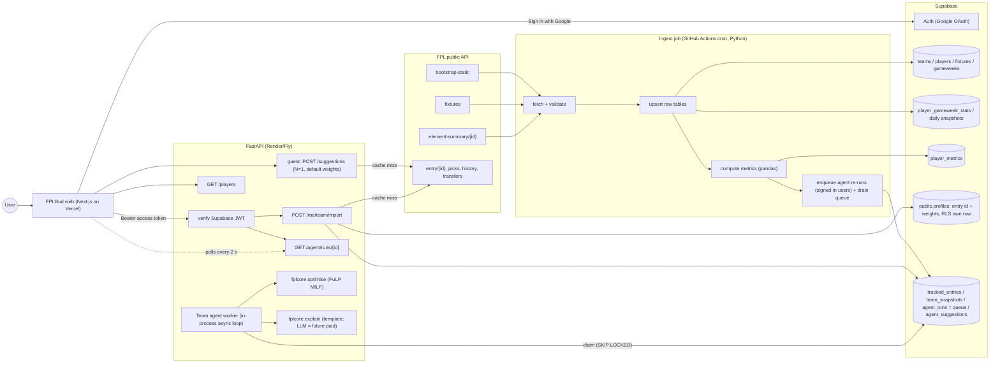

# FPLBud: Architecture (v1)

**Goal of v1:** FPLBud imports an FPL squad (picks, bank, chips, free transfers) by public team ID. **Guests** get an instant next-GW suggestion using the default metrics. **Signed-in users** (Google via Supabase Auth) save their team once, and a background **team agent** straight away produces three plans: next GW, next 3 GWs and next 5 GWs. Each plan covers transfers or a roll, hits, captain and vice, XI and bench, chip advice, and reasoning. Plans are scored by custom metrics, and users can change how much each metric counts.
**Not in v1:** squad builder, FPL account login (the official "my team" endpoint), paid tier (§2A).
**Stack:** Next.js (Vercel), Python FastAPI with pandas and PuLP (Render or Fly.io), Supabase Postgres and Auth (Google OAuth), and a GitHub Actions cron for ingestion.
**Core principle:** the heavy work happens offline. A scheduled job ingests FPL data and precomputes each player's metric components. Each request only applies the user's weights and runs a small MILP, so it should take well under 1 second. The agent's maths is deterministic; an LLM is only an optional writer of explanations, planned for the future paid tier.

---

## 0. FPL API: what we verified live (12 Oct 2026, 2026/27 season, GW6 current, GW7 deadline 17 Oct 21:00 AEDT)

All of these returned HTTP 200 without auth or a User-Agent. Responses are CDN-cached (`cache-control: max-age=300`). Saved samples are in `samples/` and can be reused as test fixtures.

| Endpoint | Status | Key findings |
|---|---|---|
| `bootstrap-static/` (1.8 MB) | 200 | `elements` (667 players), `teams` (20), `events` (38), `element_types` (4), `chips`, `game_settings`, `total_players` |
| `fixtures/` | 200 | 380 fixtures: `event, kickoff_time, team_h, team_a, team_h_difficulty, team_a_difficulty, finished, started, scores, stats[]` |
| `element-summary/{id}/` | 200 | `fixtures` (upcoming, with `difficulty` and `is_home`), `history` (one row per match: `was_home, opponent_team, minutes, starts, expected_goals/assists/goal_involvements/goals_conceded, value, selected, transfers_balance`, …), `history_past` |
| `entry/{id}/` | 200 | `current_event, last_deadline_bank, last_deadline_value, last_deadline_total_transfers`, name, leagues |
| `entry/{id}/event/{gw}/picks/` | 200 | `picks[15]` (`element, position, multiplier, is_captain, is_vice_captain, element_type`), `active_chip`, `automatic_subs`, `entry_history` (`bank, value, event_transfers, event_transfers_cost`) |
| `entry/{id}/history/` | 200 | `current[]` per GW (`event_transfers, event_transfers_cost, bank, value`, …), `chips[]` used (`name, event`), `past[]` |
| `entry/{id}/transfers/` | 200 | `element_in, element_in_cost, element_out, element_out_cost, event, time` (useful for estimating purchase and selling prices) |
| `event/{gw}/live/` | 200 | per-player stats for one GW (cheap bulk alternative to 667 element-summary calls) |
| `entry/{id}/event/{next_gw}/picks/` | **404** | picks for the upcoming GW are hidden until its deadline passes |
| `my-team/{id}/` | **403** | needs login, so **selling prices and pending transfers are not available**. We estimate them instead (see §6) |
| `entry/{bad id}/` | 404 | `{"detail": ...}`, which the UI should show as "team not found" |

**Fields we confirmed on `elements`:** `expected_goals`, `expected_assists`, `expected_goal_involvements`, `expected_goals_conceded` (strings such as "1.80"), and their `*_per_90` versions (numbers). Also `form` (string), `points_per_game`, `now_cost` (int, tenths of £m), `cost_change_start`, `cost_change_event`, `selected_by_percent` (string), `transfers_in_event`, `transfers_out_event`, `chance_of_playing_this_round` and `chance_of_playing_next_round` (null/0/50/75/100 seen), `status` (a/d/i/s/u seen), `news`, `minutes`, `starts`, `ep_next`, `ict_index`, `defensive_contribution`, `can_transact`, `removed`. There are also undocumented `price_change_percent`, `price_change_projections` and `price_change_hourly_rate`. Their meaning isn't documented, so we don't rely on them.

**Gotchas we verified:**
- Numeric fields such as `form`, `expected_*` and `selected_by_percent` come as **strings**. Cast them during ingest.
- `teams[].strength_attack_*` and `strength_defence_*` are **0 for every team** right now (`strength_overall_*` is populated). Use the fixtures' FDR (`team_h_difficulty`/`team_a_difficulty`) instead.
- `game_settings`: `squad_squadsize=15`, `squad_team_limit=3`, `squad_total_spend=1000`, `max_extra_free_transfers=4` (so up to 5 FTs), `transfers_sell_on_fee=0.5`. Read these at runtime instead of hard-coding them.
- `element_types`: GKP/DEF/MID/FWD `squad_select` = 2/5/5/3, with `squad_min_play`/`squad_max_play` for formation rules.
- Chips come in **two sets per season**: wildcard, freehit, bboost and 3xc are each available once in GW1/2–19 and once in GW20–38 (`start_event`/`stop_event`).
- Free transfers aren't exposed directly. We derive them from `history.current` (§6). The rule checked out against a real entry: it gave 1 FT for GW7, which matches that entry's −4 hit in GW6.

Etiquette: this is an unofficial API. Make one bulk call per job, throttle `element-summary` to about 3 req/s, cache entry lookups for 5 minutes, and never proxy user traffic straight to FPL without caching.

---

## 1. System diagram



## 2. Components

| Component | Responsibility |
|---|---|
| `fplcore` (shared Python package) | FPL client (typed with pydantic, retries, throttling), metric functions, optimiser, FT and selling-price logic, the team agent (`fplcore.agent`) and the explainer (`fplcore.explain`). Used by both the ingest job and the API, so everything is tested in one place. |
| Ingest job (`ingest/run.py`) | Fetches, validates and upserts raw data, takes daily snapshots, and recomputes `player_metrics` for the next 6 GWs. Then it enqueues agent re-runs for eligible signed-in users and drains the queue itself, so re-runs happen even while the API is asleep. Logs a row in `ingest_runs`. |
| FastAPI (`api/`) | Verifies Supabase JWTs. Serves guest suggestions (stateless) and, for signed-in users, profile, team import (stores a `team_snapshot`), agent runs and results. Hosts the in-process agent worker. Stateless apart from the DB. |
| Team agent worker | Signed-in users only. Claims queued `agent_runs` from Postgres and builds the team context. It runs the optimiser for horizons 1, 3 and 5 plus the chip checks, writes structured plans, then adds template explanations. See §6A. |
| Supabase | Auth (Google OAuth), Postgres storage (which also serves as the job queue) and `public.profiles`. RLS is on for every table. Users can read and update only their own profile and read only their own agent rows. Everything else is closed to browsers, and FastAPI reaches it over `DATABASE_URL`. |
| Next.js (`web/`) | FPLBud UI: guest flow, Google sign-in, onboarding (team ID), the dashboard with agent progress and three horizon tabs, settings, and the player explorer. Uses `@supabase/ssr` for the session and sends the access token to FastAPI. |

Repo layout (monorepo): `web/`, `api/`, `ingest/`, `fplcore/` (`client`, `metrics`, `optimise`, `agent`, `explain`), `db/schema.sql`, `samples/` (test fixtures), `.github/workflows/ingest.yml`.

## 2A. Users, auth and tiers

**Sign-in.** Google OAuth goes through **Supabase Auth**. The Google client ID and secret are set in Supabase (Dashboard → Auth → Providers → Google, or `config.toml` for local `supabase` CLI). Google's authorised redirect URI is `https://<project>.supabase.co/auth/v1/callback`. FPLBud calls `supabase.auth.signInWithOAuth({provider:'google', options:{redirectTo: NEXT_PUBLIC_SITE_URL + '/auth/callback'}})`, and `/auth/callback` exchanges the code for a session. **Google login does not give access to FPL accounts.** Teams are always imported by public FPL team ID, and FPL credentials are never asked for or stored.

**Profiles.** `public.profiles` has one row per `auth.users` row, created by a trigger on sign-up with the Google name and avatar. It holds `fpl_entry_id` (entered once at onboarding), saved `weights` (including optional metrics), default `horizon`/`max_hits`, `last_active_at`, `created_at` and `updated_at`. RLS lets a user select and update only their own row, and check constraints validate the values. The app writes through FastAPI, which validates the entry ID against FPL. Because of RLS, direct supabase-js access is safe too.

**JWT verification in FastAPI.** A `current_user` dependency reads `Authorization: Bearer <access_token>`. It verifies the HS256 signature with `SUPABASE_JWT_SECRET` and checks `aud = "authenticated"` and `exp`, then uses `sub` as the user ID. An `optional_user` variant is used on endpoints that guests can also call. Supabase also offers asymmetric JWT signing keys. If the project uses them, verify against the project's JWKS instead; this is isolated in `api/auth.py`. Authenticated requests bump `profiles.last_active_at`, at most once per hour.

| | **Guest** (no login) | **Free** (signed in with Google) |
|---|---|---|
| Team import | Enter a team ID each visit. Public preview only; nothing stored except the shared 5-minute cache of public FPL responses (`entry_cache`) | Team ID saved to profile once, remembered |
| Suggestions | **Next GW only**, via `POST /suggestions`. Server forces `horizon=1` and **default weights** (custom weights are ignored) | **Team agent**: three horizons (1/3/5), chip advice, XI, bench, captain, reasoning |
| Metrics | Defaults (form, fixture, home/away, xGI, value, minutes) | Custom weights, including transfer trend, saved to profile |
| Background re-runs | None | Automatic re-runs after data refresh, pre-deadline and post-deadline |
| Player explorer | ✓ (default weights) | ✓ (own weights) |
| Rate limit | Per IP (`GUEST_RATE_LIMIT_PER_MINUTE`) | Per user (`USER_RATE_LIMIT_PER_MINUTE`), agent re-runs capped (`AGENT_RERUN_LIMIT_PER_HOUR`) |

**Future paid tier (out of scope, noted only):** deadline email reminders, a multi-GW chip planner, multiple teams per account (`tracked_entries` is already keyed by (user, entry)), and LLM-written explanations (`LLMExplainer`, §6A.5).

## 3. Ingestion schedule

Run from GitHub Actions cron. It's free, needs no always-on server, and the regular writes keep the free Supabase project active. Cron is in UTC. The workflow reads `DATABASE_URL` from a repository Actions secret; a scheduled run with that secret empty exits in a few seconds.

FPL does not publish a poll interval. The cron follows the clocks they do publish, instead of fetching every 2 hours. Times below are UTC. In British Summer Time the same slots fall about an hour later in the UK, still after the event they are waiting for.

| Job | When | Calls | Notes |
|---|---|---|---|
| `prices` | daily 00:20 UTC | bootstrap + fixtures | Sits after the 00:00 UK price change. Upserts players, teams, gameweeks and the fixture list, then recomputes metrics. The first bootstrap of a UTC day also writes `player_daily_snapshots`. |
| `lock` | daily 09:15 UTC | bootstrap + fixtures + element summaries, or a short exit | Runs the full pull only when this UK date is the day after a gameweek's last kickoff. FPL confirms that gameweek at 09:00 UK. On any other morning inside the 48 hours before a deadline, it runs the pre-deadline pull instead. Otherwise it exits without calling FPL. |
| `pre_deadline` | Friday 08:00 and 18:00 UTC, and the 09:15 UTC slot while a deadline is inside 48 hours | bootstrap | A blank Friday does no work. Refreshes flags and prices, recomputes metrics, then `agent_rerun` with trigger `pre_deadline`. |
| `metrics` | at the end of each of the above | 0 | Recomputes `player_metrics` for `computed_for_gw` = next GW … next+5, with `horizon=1`. Older metric and match rows outside the rolling window are pruned. Bumps `data_version`. |
| `agent_rerun` | after the lock run and after a pre-deadline run that actually fetched | 0 until a post-deadline import | Enqueues runs for **signed-in users with a saved team** whose `profiles.last_active_at` is within `AGENT_TRACKING_WINDOW_DAYS` (default 30), then drains the queue in the same Action (§6A.6). |

## 4. Metrics

All components are computed **per player, per upcoming GW k** (k = 1…6) and stored as a `*_raw` value plus a `*_score` in [0,1]. **Normalisation:** for form, xGI, value and trend, the score is the *percentile rank within position*. We use pandas `rank(pct=True)` over players with at least 1 appearance in the last 5 rounds; everyone else scores 0. Percentiles handle outliers and early-season noise well, and they keep the weights comparable. Fixture, home and minutes are naturally bounded, so they use an absolute 0–1 mapping. That way a genuinely easy fixture still scores high even if everyone's fixtures are easy.

### 4.1 Default metrics (on by default)

| Metric | Raw formula | Score | Default weight |
|---|---|---|---|
| **Form** | `0.5 × float(form) + 0.5 × EWMA(total_points per appearance, last 5 rounds, α=0.5)` | percentile within position | **0.30** |
| **Fixture difficulty** | for GW k: mean over that GW's fixtures of `ease = 0.5 × (5 − FDR)/4 + 0.5 × opponent form`. FDR is `team_h_difficulty` at home, else `team_a_difficulty`. Opponent form is that team's percentile for xG conceded (MID/FWD) or one minus its percentile for xG created (GKP/DEF), over the last 6 finished matches, shrunk to the league mean with a 3-match prior. With no finished matches the form half is dropped and ease is the FDR term alone | blended ease (still 0–1; FDR 2 alone is 0.75) | **0.25** |
| **Home/away** | share of the player's fixtures in GW k that are at home | 1 = home, 0 = away, 0.5 for a split double | **0.10** |
| **Expected stats** | `xp90 = 0.6 × recent90 + 0.4 × season90`, shrunk to the position mean: `(m·xp90 + 270·prior)/(m+270)` where m = minutes. Points-weighted: `goal_pts[pos]·xG + 3·xA` (goal points GKP/DEF 6, MID 5, FWD 4). For GKP/DEF, add `4·exp(−xGC90)` as a clean-sheet proxy (Poisson P(0 conceded)). | percentile within position | **0.35** |
| **Value for money** | `points_per_game / (now_cost/10)` | percentile within position | **0.15** |
| **Minutes security** | EWMA of starts over the last 6 matches (α=0.4, newest weighs most), times `0.35 + 0.65 ×` the same weighted average of `min(minutes, 90) / 90` on those starts | direct (0–1). A 70-minute starter keeps about 0.85 | **0.15** |

### 4.2 Optional metric (off by default, weight 0; the UI suggests 0.15 when it is switched on)

| Metric | Raw formula | Score |
|---|---|---|
| **Price/ownership trend** | `(transfers_in_event − transfers_out_event) / total_players`, plus the 7-day change in `now_cost` from snapshots. These counters reset each deadline, so divide by hours since the deadline. | percentile across all players |

### 4.3 Combining (per request)

```
S[p,k]    = Σ_i w_i · score_i[p,k] / Σ_i w_i                   # user weights, renormalised
avail[p,k]= 1 − (1 − cop_p) · 0.5^(k−1)                         # cop = chance_of_playing_next_round/100; null & status 'a' → 1; status 'u' → 0
proj[p,k] = n_fixtures[p,k] · avail[p,k] · (a_pos + b_pos · S[p,k])   # blank GW → 0, double GW → ×2
```

`(a_pos, b_pos)` turns a score into expected points, which is needed to compare against a −4 hit. **Start with a fallback** of a=1, b=6 (S=1 is about 7 pts). The live database only keeps metric rows for the next 6 gameweeks, so any later calibration uses a local export or `scripts/backtest.py`. As a sanity check, compare the correlation of `proj[p,1]` with FPL's `ep_next`.

## 5. Transfer optimisation (PuLP / CBC MILP)

Inputs: current squad C, bank B, free transfers F, selling prices sell_p, purchase prices cost_p = now_cost, horizon N (default 3), discount δ = 0.85, max hits H (default 1), and optional lock/exclude lists.

Variables (binary unless noted): `x_p` (in the squad after transfers), `in_p`, `out_p`, `s_p` (starts in GW1 of the horizon), `c_p` (captain), and integer `h ≥ 0` (paid transfers).

```
max   Σ_p proj[p,1]·(s_p + c_p + 0.1·(x_p − s_p))                # XI + captain double + small bench value
    + Σ_p Σ_{k=2..N} δ^(k−1) · proj[p,k] · x_p                     # later GWs, squad-level
    − 4·h
s.t.  x_p = [p∈C] + in_p − out_p ;  in_p ≤ 1−[p∈C] ;  out_p ≤ [p∈C]
      Σ x_p = 15 ;  Σ_{pos} x_p = 2/5/5/3                            # element_types.squad_select
      Σ_{p∈club} x_p ≤ 3                                             # game_settings.squad_team_limit
      Σ in_p·cost_p ≤ B + Σ out_p·sell_p                             # budget
      Σ in_p − F ≤ h ;  h ≤ H                                        # −4 per extra transfer
      Σ s_p = 11 ; s_p ≤ x_p ; GKP = 1 ; DEF ≥ 3 ; MID ≥ 2 ; FWD ≥ 1  # element_types min/max_play
      Σ c_p = 1 ; c_p ≤ s_p
      in_p = 0 for can_transact = false, removed, or excluded ;  out_p = 0 for locked
```

**Output:** separate solves with `Σ in_p` fixed at 0 (roll), 1, 2, …, up to F+H. Each comes back as a plan card showing projected gain against rolling, the transfers in and out with a per-metric breakdown (why), the captain and vice-captain (the next-best starter), and the remaining bank. About 700×6 variables solves with CBC in roughly 100–300 ms. Pre-filtering to the top 40 per position by S makes it even faster. Horizon-specific settings for the agent are in §6A.3, and chip advice is in §6A.4. If `active_chip` is wildcard or freehit, we treat F as unlimited.

Suggested transfers (`POST /me/suggested-transfers`) call the same solver with `alternatives_per_count=3` and no hits. For each transfer count above zero, the next solve forbids the previous incoming set (`sum of those in_p ≤ size − 1`), so the options are different players rather than the same squad counted twice. The advice then shows the roll plus the two transfers with the best net value. A move is only the recommendation when it beats the value of keeping that free transfer. The language-model dossier, when the model is on, includes the next three gameweeks and each opponent's attack and defence form.

## 6. Team import logic (public team ID; no FPL login exists or is needed)

1. `entry/{id}/` gives `current_event` (the latest started GW, here 6) and `last_deadline_bank`.
2. `entry/{id}/event/{current_event}/picks/` gives the 15 elements and `entry_history.bank`.
3. **Free transfers**, derived from `history.current` and `history.chips`. FT = 1 going into GW2 (GW1 transfers are unlimited). For each later finished GW g:
   if a wildcard or freehit was played in g, keep the FT count; otherwise
   `free_used = event_transfers − event_transfers_cost/4`, then `FT = clamp(FT − free_used + 1, 1, 1 + max_extra_free_transfers)`.
   This checked out on a real entry (gave 1 FT for GW7). How FTs carry over when a WC or FH is played should be confirmed against the official rules. The UI always lets the user override FT.
4. **Selling price estimate.** The purchase price is the most recent `element_in_cost` from `entry/{id}/transfers/`. If the player was held since GW1, use `now_cost − cost_change_start`. Then `sell = buy + floor((now − buy)/2)` if now > buy, else `now`. Mark this as an estimate, since the bank can also be overridden.
5. **Caveat shown in the UI:** transfers already made for the *next* GW aren't visible until its deadline (picks return 404, my-team returns 403). The squad can be edited by hand before generating suggestions.

## 6A. Team agent (signed-in users; runs in the background after import)

**Signed-in users only.** Guests get the synchronous next-GW plan from `POST /suggestions` and never create snapshots or runs. As soon as a signed-in user saves or re-imports their team, the agent produces **three independent plans**: **next GW (N=1)**, **next 3 GWs (N=3)** and **next 5 GWs (N=5)**. Each plan has transfers (or a roll), any worthwhile hits, captain and vice, the starting XI and bench order, chip advice, and plain-English reasoning. **The maths is fully deterministic** (optimiser plus rules). The LLM only rewrites structured output as prose and is optional (future paid tier).

### 6A.1 Team context (`team_snapshots`)
On import, §6 builds an immutable snapshot that is stored once and reused by every run:
`{entry_id, event, picks[15], bank, value, free_transfers (est.), selling_prices{element: price} (est.), chips_available[] (current half only, with stop_event), chips_used[], active_chip, flags[] (squad players with status ≠ 'a' or chance_of_playing_next_round < 100, with news), overrides (user-edited FT/bank/squad)}`, plus a `content_hash` and the `user_id` that created it (overrides are per user). A re-import with the same hash reuses the snapshot.

### 6A.2 How it runs asynchronously: a Postgres-backed queue (no Redis, no extra service, free)
- **Queue = the `agent_runs` table.** Status moves `queued → running → succeeded | failed`. Rows also carry `progress` (0–100) and `stage` (`context`, `horizon_1`, `horizon_3`, `horizon_5`, `chips`, `explain`).
- **Enqueue:** `PUT /me/team` or `POST /me/team/import` (JWT required) writes the snapshot, inserts a `queued` run with `user_id`, and returns `run_id` straight away (around 300 ms). A partial unique index allows at most one queued or running run per (user, entry), so repeat clicks just get the existing run.
- **Claim:** `UPDATE agent_runs SET status='running', started_at=now(), attempts=attempts+1, locked_by=$worker WHERE id = (SELECT id FROM agent_runs WHERE status='queued' ORDER BY priority, created_at FOR UPDATE SKIP LOCKED LIMIT 1) RETURNING *`. This is safe even if two workers race.
- **Who runs it:**
  - (a) **In the API process.** On import, a FastAPI `BackgroundTasks` call claims and runs the job immediately. An asyncio loop started at app startup also polls every `AGENT_POLL_INTERVAL_SECONDS` (5 s) for anything left over.
  - (b) **In the ingest GitHub Action.** After enqueuing re-runs, the Action drains the queue itself with the same `fplcore.agent`. This means the free Render instance can be asleep and re-runs still happen.
  - There's no Celery or Redis. If load ever grows, a dedicated worker can run the same loop.
- **Reliability:** if a run has been `running` for more than `AGENT_JOB_TIMEOUT_SECONDS` (300 s), it goes back to `queued` (up to `AGENT_MAX_ATTEMPTS` = 3), then to `failed` with the `error` text. The worker is idempotent: it deletes and rewrites `agent_suggestions` for that run in one transaction.
- **Expected runtime:** a few seconds. Each horizon is about 3–6 MILP solves at 100–300 ms each, the chip checks add 3 solves, and the optional LLM call adds 2–6 s.

### 6A.3 Horizons and the optimiser
All three horizons use the §5 MILP on the same snapshot, with the user's weights. Transfers are only made **now**: v1 decides this GW's transfers and then holds the squad across the horizon. Planning future transfers across several GWs is a later enhancement.

| | N=1 | N=3 | N=5 |
|---|---|---|---|
| Objective GWs | GW+1 | GW+1…+3, δ=0.85 | GW+1…+5, δ=0.85 |
| Hit rule: take a −4 only if extra projected gain ≥ | 4 + 2.0 | 4 + 1.0 | 4 + 0.5 |
| Value of rolling, added per unused FT (up to the cap) | 2.0 | 1.0 | 0.5 |
| Max hits (default) | 1 | 1 | 2 |
| Plans returned | best, and roll as the alternative | best, roll, and best with one fewer transfer | same as N=3 |

Why it's set up this way: short horizons overrate one-week punts, so a hit has to clear a higher margin and a saved free transfer counts for more. Longer horizons spread a hit's cost over more GWs. The margins are tunable constants and get checked in the M7 backtest. The **XI, bench order and captain/vice are always picked for GW+1**, because those are the decisions due before the next deadline. For N=3/5 the output also lists each player's projection per GW so the reasoning can mention upcoming swings.

### 6A.4 Chip advice (rule-based, only for chips available in the current half)

| Chip | Check | Advise if |
|---|---|---|
| Bench Boost | sum of bench `proj` per GW in the horizon (after the plan's transfers) | best GW bench ≥ 12 pts, or 2+ bench players have a double |
| Triple Captain | captain `proj` per GW in the horizon | best GW ≥ 10 pts (usually a double GW) |
| Free Hit | solve a one-GW squad with unlimited transfers on budget = selling value + bank, and compare with the best normal XI | gain ≥ 12 pts, or 4+ squad players blank |
| Wildcard (N=5 only) | solve with unlimited transfers over N=5 and compare with the best normal plan | gain ≥ 20 pts; also returns the wildcard squad |

Each tip is `{chip, recommend: play_now | consider_gw_X | hold, expected_gain, reason_codes}`. For N=1 only `play_now` or `hold` applies; N=3/5 can say "best GW within the horizon". There's a "use it or lose it" warning when a chip's `stop_event` is 3 or fewer GWs away. All thresholds are constants to tune.

### 6A.5 Explanations: deterministic first, LLM optional
- The agent writes a **structured result** per horizon: transfers with per-metric score deltas, `proj` gain against rolling, hit maths, captain choice and margin, flags affecting the plan, chip tips, and `reason_codes` (for example `FLAG_INJURED_OUT`, `FIXTURE_SWING`, `XGI_UPGRADE`, `HIT_NOT_WORTH`).
- `Explainer` interface: `explain(result: HorizonResult) -> str`.
  - **`TemplateExplainer` (default, always available, free).** It builds sentences from the reason codes and numbers. For example (illustrative): *"Sell Saka (75% chance of playing, tough away games) for Palmer (+1.8 projected over 3 GWs, top-10% expected stats). Rolling instead is worth less. Captain Haaland, 1.9 pts ahead of Palmer."*
  - **`LLMExplainer` (optional; planned for the future paid tier, off for Free).** Enabled with `LLM_ENABLED=true` and `LLM_PROVIDER`/`LLM_API_KEY`/`LLM_MODEL`; it works with any OpenAI-compatible endpoint. It makes **one call per run** covering all 3 horizons, with JSON in and JSON out (about 2k input and 600 output tokens). The prompt says to only use names and numbers from the input. Afterwards we check that every player name and number in the output appears in the input; on failure, a timeout longer than `LLM_TIMEOUT_SECONDS`, or a missing key, it falls back to the template. The output is stored with `explanation_source`.
  - **Cost:** a small model at this token count costs a fraction of a cent per run. Some providers have free API tiers, but their limits and terms change, so check them at deploy time. To control cost, the LLM is used only for user-triggered runs, and background re-runs reuse the stored text when the `plan_hash` hasn't changed (otherwise they use the template). There's a daily call cap (`LLM_DAILY_CALL_CAP`).

### 6A.6 When it re-runs (`trigger` column)

| Trigger | What happens |
|---|---|
| `import` | Onboarding, team change or re-import (signed in). If the snapshot hash, weights and `data_version` all match the latest successful run, that run is returned and nothing new is queued. |
| `user_rerun` | The user saved new weights in settings or pressed "Re-run agent" (capped by `AGENT_RERUN_LIMIT_PER_HOUR`). |
| `data_refresh` | After a `metrics` ingest with a new `data_version`, for every signed-in user with a saved team (`tracked_entries`) and `profiles.last_active_at` within `AGENT_TRACKING_WINDOW_DAYS` (default 30; inactive users are skipped to save compute and resume on their next visit). Uses the weights saved on the profile. Low priority, and capped per Action run. |
| `pre_deadline` | 2 h before the deadline, after the pre-deadline ingest, so injury news is included. |
| `post_deadline` | After the deadline, the entry is re-fetched (new picks are now visible), a new snapshot is made, and the agent runs. |

### 6A.7 How the frontend shows progress
**Polling** `GET /agent/runs/{run_id}` (with the Bearer token) every 2 s (backing off to 5 s, stopping at `succeeded`/`failed` or after 2 min). It shows a step indicator driven by `stage`/`progress`, then three tabs. We chose polling over Supabase Realtime because it's simpler and keeps the API as the single read path. The owner-only RLS select policies on `agent_runs` and `agent_suggestions` mean Realtime could be switched on later without schema changes. When a newer successful run exists than the one on screen, the page shows a "Plans updated (injury news / data refresh)" banner.

## 7. FastAPI endpoints

Auth: **Public** = anyone, rate-limited by IP. **Optional** = guest behaviour unless a valid JWT is sent. **User** = a valid Supabase JWT is required (401 otherwise). **Internal** = `X-Internal-Secret: INTERNAL_API_SECRET`.

| Method & path | Auth | Purpose |
|---|---|---|
| `GET /health` | Public | liveness check, plus the last successful `ingest_runs` time and queue depth |
| `GET /meta` | Public | current/next GW, deadline, default weights, metric descriptions, game settings, `data_version` |
| `GET /public/team/{entry_id}` | Public | guest preview: squad, bank, estimated FT and selling prices, chips and flags. Uses `entry_cache` only; nothing stored |
| `POST /suggestions` | Optional | Guests get body `{entry_id, overrides?}` with **horizon 1 and default weights enforced server-side** (client values ignored). Signed-in users can also send `{weights, horizon:1-6, max_hits, lock_ids, exclude_ids}` for instant slider previews. Synchronous. |
| `GET /players?position=&team=&max_cost=&horizon=` | Optional | ranked player list; default weights for guests, profile weights (or `weights=` query) for users |
| `GET /players/{id}` | Public | metric breakdown per upcoming GW, plus recent match history |
| `GET /stats/market` | Public | top transfers in/out this GW, 24h net movers, price risers/fallers, estimated price pressure |
| `GET /stats/insights?position=` | Optional | in-form, finishing variance, differentials, defensive contributions, bonus, set-piece takers. Default weights for guests, profile weights for users |
| `GET /me/stats/squad` | User | captaincy board (next-GW proj), template threats, squad differentials, ownership profile. Uses the latest snapshot; no FPL call |
| `GET /me/stats/season` | User | GW history vs average, rank, bench points, hits, captain returns vs the crowd. First load fetches missing finished-GW picks (cached in `entry_event_picks`) |
| `GET /me` | User | profile (entry ID, weights, defaults) plus latest snapshot and `latest_run_id` |
| `PUT /me` | User | update weights, horizon and hit defaults. Changing weights enqueues a `user_rerun` |
| `PUT /me/team` | User | body `{entry_id}`. Validates against FPL `entry/{id}`, saves it to the profile, upserts `tracked_entries`, then imports as below |
| `POST /me/team/import` | User | body `{overrides?:{free_transfers, bank, squad[15]}}`. Fetches from FPL (5-minute cache), stores a `team_snapshot`, and enqueues an agent run. **Returns `202 {snapshot, run_id, status}`** |
| `POST /me/agent/rerun` | User | returns `202 {run_id}` (capped by `AGENT_RERUN_LIMIT_PER_HOUR`) |
| `GET /me/agent/latest` | User | latest successful run with all three horizon results |
| `GET /agent/runs/{run_id}` | User | `{status, stage, progress, error?, created_at, finished_at, data_version, results?:{"1":HorizonPlan,"3":…,"5":…}}`. Returns 404 unless `run.user_id = sub` |
| `DELETE /me` | User | deletes the account: the auth user via the service role admin API, then everything cascades |
| `POST /internal/agent/drain` | Internal | optional manual or cron trigger to process the queue |

`HorizonPlan = {horizon, transfers:[{out,in,cost_delta,metric_deltas}], hits, gain_vs_roll, roll_alternative, xi[11], bench[4] (ordered), captain, vice, chips:[ChipTip], flags, reason_codes, projected_points_by_gw, explanation, explanation_source}`. The guest `POST /suggestions` returns the same shape for N=1 (without chip advice).
Validate with pydantic, rate-limit with slowapi (per IP for guests, per `sub` for users), and set CORS from `CORS_ALLOWED_ORIGINS`.

## 7A. Chat assistant

Signed-in only. Whether chat is on, and which model it uses, are `CHAT_ENABLED` and `CHAT_MODEL` in `fplcore/constants.py`. When `CHAT_ALLOWED_USER_IDS` is set, only those user ids can open a thread.

The loop lives in `fplcore/chat` and does not import FastAPI. `api/chat` builds the pinned context, the tools, and the SSE stream. The web app does not call Render directly: `POST /api/chat/stream` reads the Supabase session and pipes `POST /chat/threads/{id}/messages`.

Tools are read-only except `save_preference`, which only proposes a row until `POST /chat/memory/confirm`. Projections, legality and hit maths come from the existing optimiser, `fplcore/rules.py` and the metrics. The model explains. Answers are checked against the tool results before `message.final`.

The stream route uses `chat_user`, which closes its database connection before the first byte. It does not use `deps.db_conn`, because that dependency holds a pooled connection until the response finishes.

| Method & path | Purpose |
|---|---|
| `GET /chat/health` | Whether chat is on for this user |
| `POST /chat/threads`, `GET /chat/threads`, `DELETE /chat/threads` | Create, list, delete every thread |
| `GET /chat/threads/{id}`, `DELETE /chat/threads/{id}` | One thread. Another user's id is 404 |
| `POST /chat/threads/{id}/messages` | SSE turn. `409` if one is already running. Idempotent on `client_msg_id` |
| `POST /chat/messages/{id}/feedback` | Useful / not useful |
| `GET /chat/usage` | Turns left today |
| `GET /chat/memory`, `POST /chat/memory/confirm`, `DELETE /chat/memory` | Saved preferences |

Tables, added in `db/migrations/010_chat.sql`: `chat_threads`, `chat_messages`, `chat_turns`, `chat_tool_calls`, `chat_memory`, `chat_memory_proposals`, `chat_usage`, `chat_usage_global`. Daily caps are keyed by the JWT `sub`. `prune_retention` drops threads after 90 days, clears tool results after 14, and drops usage after 35. Replay is `python -m api.chat.replay <turn_id>`, refused in production when `CHAT_ADMIN_USER_IDS` is empty.

## 8. Frontend pages (Next.js App Router, Tailwind, shadcn/ui, `@supabase/ssr`)

- `/` (landing): FPLBud pitch, a team ID input for guests (with help on finding it: the number in the URL of the FPL "Points" page), and a **Sign in with Google** button.
- `/try/[entryId]` (guest): squad on the pitch from `/public/team`, plus the **Next GW** plan from `/suggestions` (default metrics). The **Next 3 / Next 5 tabs are rendered blurred** with an overlay: *"Sign in with Google to unlock your 5-week plan"*. Weight sliders are shown disabled with the same call to action.
- `/login` and `/auth/callback`: Google OAuth through Supabase. New users are sent to onboarding.
- `/onboarding` (user): enter the FPL team ID once. It's validated with a preview of the manager and team name, then saved with `PUT /me/team`, and the agent starts.
- `/dashboard` (user): pitch view and context panel (bank, FT, chips, flagged players), then **section tabs: Plans / My squad / My season / Market / Insights** (`?section=`). **Plans** keeps the agent panel with progress steps while polling, then **three horizon tabs: Next GW / Next 3 / Next 5**. Each plan tab shows transfer cards (or "Roll"), hit maths, XI and bench, captain and vice, chip tips and the explanation. There's a "Plans updated" banner when a background re-run finishes, and a "Re-run agent" button. **Market** is top transfers in/out, 24h movers, price risers/fallers and estimated price pressure (labelled as an estimate: FPL does not publish the algorithm). **My squad** is the captaincy board, template threats and differentials. **My season** is GW points vs average, rank, bench, hits and captain returns. **Insights** is form, finishing variance, DC hit rate, bonus and set pieces. Player lists mark "you own" from the squad on the page, so the public market/insights payloads stay cacheable.
- `/settings` (user): metric weights and optional-metric toggles (saved to the profile), default horizon and max hits, changing the FPL team ID, chat preferences, delete chat history, sign out, and delete account.
- `/chat` (user): the assistant. Citation chips do not link to a player page.
- `/players`: explorer (profile weights when signed in).
- `/how-it-works`: metric formulas, horizon and hit rules, and chip thresholds in plain English.

Next.js middleware redirects `/onboarding`, `/dashboard` and `/settings` to `/login` when there's no session. A signed-in user without `fpl_entry_id` is sent to `/onboarding`.

## 9. Build plan (solo, part-time)

| Milestone | Deliverable | Done when |
|---|---|---|
| **M0 Setup** (2–3 days) | Monorepo, Supabase project, `schema.sql` applied, `.env` loading (§10) | Tables exist and the Python client can connect |
| **M1 Data pipeline** (1 week) | `fplcore.client` with pydantic models and string→number casting, ingest for bootstrap, fixtures and element-summary, the GitHub Actions cron, `ingest_runs` and `data_version` | DB refreshes on schedule unattended, and tests pass against `samples/*.json` |
| **M2 Metrics** (1 week) | `fplcore.metrics` computing all 7 components for the next 6 GWs, plus `GET /players` | Top players per position look sensible, and `proj` correlates with `ep_next` |
| **M3 Team import** (3–4 days) | FT, selling-price and flag logic, `GET /public/team/{id}`, snapshot builder | Tests pass for the sample entry (FT=1 for GW7) and the 404 case |
| **M4 Optimiser + guest flow** (1 week) | `fplcore.optimise` with horizon settings (§6A.3), and `POST /suggestions` with guest enforcement plus IP rate limit. Minimal `/` and `/try/[id]` pages | A guest gets a valid next-GW plan in under 1 s, and property tests pass for the constraints |
| **M5 Auth + profiles** (4–5 days) | Google provider in Supabase, `profiles` with trigger and RLS, `api/auth.py` JWT dependency, `/me` endpoints, `/login`, `/auth/callback`, `/onboarding`, middleware | Sign in → enter team ID → it's remembered on the next visit. One user can't read another's profile or runs (RLS and API tests) |
| **M6 Team agent** (1 week) | `agent_runs` queue (claim with SKIP LOCKED, retry and stale-run handling), the in-process worker and BackgroundTasks kick-off, three horizon plans, XI/bench/captain, `TemplateExplainer`, `/me/team/import`, `/agent/runs/{id}` | After onboarding, three plans appear in under 10 s, and a killed worker still ends in a finished run after retry |
| **M7 Dashboard + deploy** (1–2 weeks) | `/dashboard` with polling and horizon tabs, `/settings`, blurred guest tabs, deployed to Vercel, API on Render/Fly, Sentry | End-to-end works for both a guest and a signed-in user on a real team ID |
| **M8 Agent extras + polish** | Chip advice (§6A.4), cron re-runs (`data_refresh`/`pre_deadline`/`post_deadline`) with the inactivity cutoff, backtest to tune margins and a/b calibration | Re-runs happen with no user action, and inactive users are skipped |

**First milestone after setup is still M1.** Get reliable, scheduled, typed data into Postgres before writing any metric, agent or UI code. Auth (M5) comes after guest value works (M4) and before the agent (M6), because the agent is signed-in only.

## 10. Configuration (`.env`)

| Variable | Used by | Purpose |
|---|---|---|
| `APP_ENV` | all | `development` / `production` (log level, strictness) |
| `NEXT_PUBLIC_SITE_URL` | web | base URL, used for the OAuth `redirectTo` |
| `NEXT_PUBLIC_API_URL` | web | FastAPI base URL |
| `CORS_ALLOWED_ORIGINS` | api | comma-separated allowed origins |
| `NEXT_PUBLIC_SUPABASE_URL`, `NEXT_PUBLIC_SUPABASE_ANON_KEY` | web | Supabase client (auth session; RLS-limited) |
| `SUPABASE_SERVICE_ROLE_KEY` | api | admin actions only (deleting users). **Never exposed to the browser** |
| `SUPABASE_JWT_SECRET` | api | verifying user access tokens |
| `DATABASE_URL` | api, ingest | Supavisor transaction-mode pooler (port 6543). Bypasses RLS; server-side only |
| `DB_POOL_MIN_SIZE`, `DB_POOL_MAX_SIZE` | api | Client-side psycopg pool (default 1–8) so free-tier connection limits hold |
| `GOOGLE_CLIENT_ID`, `GOOGLE_CLIENT_SECRET` | Supabase config | entered in the Supabase Google provider (or `config.toml` locally); not read by app code |
| `FPL_API_BASE_URL`, `FPL_REQUEST_TIMEOUT_SECONDS`, `FPL_MAX_REQUESTS_PER_SECOND` | fplcore | FPL client (base URL `https://fantasy.premierleague.com/api`, throttle about 3/s) |
| `INTERNAL_API_SECRET` | api, GitHub Actions | `X-Internal-Secret` header for `/internal/*` |
| `AGENT_POLL_INTERVAL_SECONDS` | api worker | queue poll interval (default 5) |
| `AGENT_JOB_TIMEOUT_SECONDS` | worker | a running job older than this is requeued (default 300) |
| `AGENT_MAX_ATTEMPTS` | worker | retries before `failed` (default 3) |
| `AGENT_TRACKING_WINDOW_DAYS` | ingest | background re-runs only for users active within N days (default 30) |
| `LLM_ENABLED`, `LLM_PROVIDER`, `LLM_API_KEY`, `LLM_MODEL`, `LLM_TIMEOUT_SECONDS`, `LLM_DAILY_CALL_CAP` | explain | `LLMExplainer` (default `LLM_ENABLED=false`; future paid tier) |
| `SENTRY_DSN` | api, web, ingest | error tracking (optional) |
| **New:** `GUEST_RATE_LIMIT_PER_MINUTE` | api | per-IP limit for public endpoints (suggested 10) |
| **New:** `USER_RATE_LIMIT_PER_MINUTE` | api | per-user limit for `/me*` and `/suggestions` (suggested 30) |
| **New:** `AGENT_RERUN_LIMIT_PER_HOUR` | api | manual re-runs and weight-change re-runs per user (suggested 6) |
| `CHAT_ALLOWED_USER_IDS` | api | Comma-separated user ids. Empty means every signed-in user |
| `CHAT_ADMIN_USER_IDS` | api | Required in production before `python -m api.chat.replay` will print a turn |
| `CHAT_LLM_API_KEY`, `CHAT_LLM_BASE_URL`, `CHAT_LLM_FALLBACK_MODEL` | api | Key and endpoint for the model named by `CHAT_MODEL`. Separate from `LLM_DAILY_CALL_CAP` |
| `CHAT_USER_TURNS_PER_DAY`, `CHAT_USER_TURNS_PER_DAY_NOTEAM` | api | Daily question caps (20 with a saved team, 10 without) |
| `CHAT_GLOBAL_DAILY_USD`, `CHAT_USER_OPTIMISER_PER_HOUR` | api | Spend cap and optimiser cap |

The GitHub Actions ingest workflow needs `DATABASE_URL`, `FPL_*`, `AGENT_*` and `SENTRY_DSN` as repository secrets.
